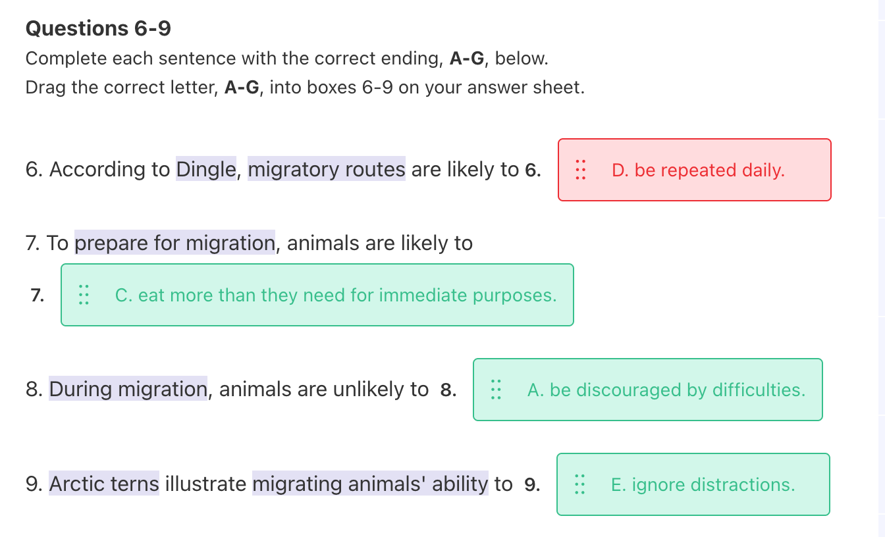

## 1. 什么是句子配对题？

**Matching Sentence Endings（句子配对题）** 是将题干前半部分（Sentence Beginnings）与选项中的后半部分（Sentence Endings）进行匹配，组合成语义完整、逻辑正确的句子

### 1.1. 题目结构

- 题干：句子的前半部分，通常包含关键信息和定位词
- 选项：句子的后半部分，需要根据原文信息进行匹配

### 1.2. 题型特点

- **没有 NB（Notices / 注意事项）**：选项通常不能重复使用，每个选项最多使用一次
- **存在干扰选项**：一定会有选项不会被选中
- **考查内容**：理解原文、同义替换、逻辑关系以及语法结构

### 1.3. 是否乱序？

- **一般顺序出题**：题目答案通常按照其在原文中出现的顺序排列
- 例如，第 2 题的定位通常在第 1 题和第 3 题定位范围之间

> 注：虽然整体上通常按照原文顺序出题，但仍需以原文实际信息为准，不要仅凭题号推断答案

### 1.4. 实际题目案例

## 3. 句子配对的做题步骤

### 3.1 划（分析题干和选项）

- 划出所有题干的关键信息和定位词
- 划出所有选项的关键信息，理解每个选项的主要意思
- 注意选项中的限定词、逻辑关系及因果关系

### 3.2 读（定位原文）

- 回到原文，逐个扫读题干定位词，寻找对应位置
- 找到定位词后，阅读定位词附近的句子，初步确认题干关键信息是否出现
- 不要只凭定位词出现就直接确定答案，需要进一步确认语义

### 3.3 对（匹配选项）

仔细阅读原文，按照以下顺序逐步扩大阅读范围：

1. 定位句本句
2. 定位句后一句
3. 定位句前一句
4. 定位句所在段落
5. 下一段

根据原文信息，对比题干和选项，判断哪个选项能够完整匹配题干含义

## 4. 注意事项

### 4.1 定位

- 一般顺序出题
- 例如：第 2 题的定位，大概率在第 1 题和第 3 题之间
- 利用前后题的定位范围，缩小搜索区域，提高定位效率

### 4.2 题干

- 题干的关键信息和定位词可能不会全部出现在同一句话中
- 需要结合上下文理解，避免因某个关键词出现就认定是定位句

### 4.3 选项

- 没有 NB，每个选项只能选 1 次
- 一定有选项不会被选到
- 注意选项之间的区别，尤其是相似选项中的关键信息、限定条件和逻辑关系

### 4.4 答案

- 时间充裕时，将题干与选项连起来完整阅读
- 检查组合后的句子是否语法正确、语义连贯、逻辑合理
- 确认答案是否符合原文，而不是仅凭常识判断

## 5. 句子配对误选的原因

### 5.1 对定位的模糊判断

- 仅定位词出现，不足以确认定位
- 定位词和题干关键信息都在原文中得到体现，才能进一步确认定位
- 注意原文可能通过同义替换表达题干信息

### 5.2 对选项的模糊判断

- 同义替换必须建立在对原文和选项完整理解的基础上
- 不能只凭个别单词相似就选择答案
- 需要完整匹配题干中的关键信息，不能遗漏重要信息或限定条件

## 6. 核心做题思路

**划关键信息 → 定位原文 → 阅读上下文 → 对比选项 → 验证完整句意**

- 定位：确认题干关键信息在原文中出现
- 理解：理解原文真正表达的含义
- 匹配：判断选项是否完整对应原文信息
- 验证：将题干与选项组合，检查语法、语义和逻辑
