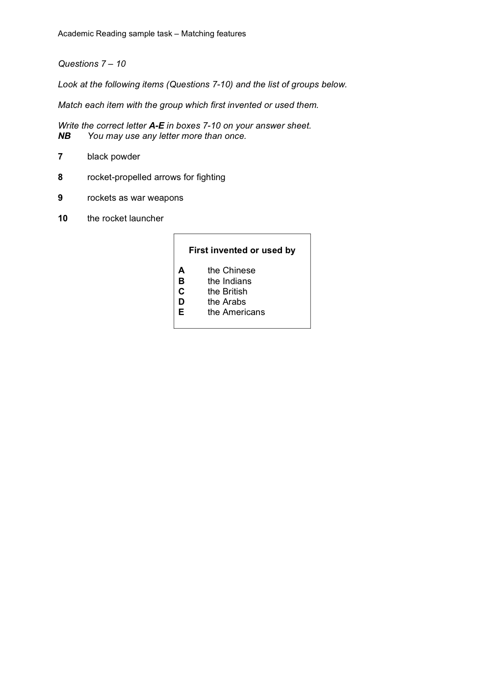

## 1. 什么是名词配对？

**名词配对题（Matching Features）** 是将题干中的陈述（Statements）与选项中的名词（人名、地名、组织名、公司名等）进行匹配，找出哪个名词"持有"该观点或"对应"该信息

### 题目结构

- 题干：陈述句，描述某个观点、特征或事实，通常包含关键信息和定位词
- 选项：名词列表，例如：
    - 人名：A. James Smith　B. Maria Jones　C. Robert Johnson ...
    - 地名 / 组织名 / 公司名：A. Tokyo　B. NASA　C. Google ...

### 题型特点

- **注意 NB**：NB 出现时，某个选项名词可能被选 2 次
- **存在干扰选项**：选项数量通常多于题干数量，一定有名词不会被选到
- **主要考查**：观点归属判断、同义替换、定位能力

### 与句子配对的区别

- **句子配对（Matching Sentence Endings）**：选项是句子的后半部分，必须与题干语法衔接、拼接成完整句子
- **名词配对（Matching Features）**：选项是独立的名词，不与题干拼接，只做信息归属判断

### 是否乱序？

- **乱序题**：题干在原文中的出现顺序与题号顺序**不对应**，不能按题号顺序依次向后找
- 这正是这类题的核心难点：无法像填空题那样"顺着找"，必须**先用选项名词定位**（人名、地名等），再在名词附近寻找题干关键信息
- 选项中的名词（尤其是人名）通常集中出现在原文某几段中，可以先标出所有名词的位置，再逐题归属

## 2. 实际题目案例

IELTS Academic Reading 官方样题（Questions 7–10），主题为火箭的发明与发展。题干为发明的条目，选项 A–E 为名词（群体名：the Chinese, the Indians, the British, the Arabs, the Americans）。

### 2.1 题目呈现形式

- 指令为 "Match each item with the group which first invented or used them"：将题干条目与"首先发明或使用该物"的群体配对
- 题干：独立的名词短语条目（如 black powder、the rocket launcher），不是句子前半部分
- 选项：独立的名词，不与题干拼接，只做信息归属判断
- **NB 出现**："You may use any letter more than once" —— 同一选项可以选多次
- 答案：7–A，8–A，9–B，10–E。可见 **A（the Chinese）被选了 2 次**，**C（the British）未被使用**

### 2.2 做题过程示范

**第 7 题 — 答案 A（the Chinese）**

- 划：题干条目 "black powder"（黑火药）
- 读：原文首句 "The invention of rockets is linked inextricably with the invention of 'black powder'. Most historians of technology **credit the Chinese with its discovery**."
- 对："credit the Chinese with its discovery" 即"将发现归功于中国人"，同义替换题干 "first invented by the Chinese"
- 验证：归属明确，答案 A

**第 8 题 — 答案 A（the Chinese）**

- 划：题干条目 "rocket-propelled arrows **for fighting**"（用于作战的火箭推动箭矢）
- 读：原文 "The Chinese relied on this type of technological development to produce incendiary projectiles... explosive grenades... to **repel their enemies**"
- 对："repel their enemies（击退敌人）" 同义替换 "for fighting"；箭矢类武器描述对应 "arrows like flying leopards"
- 验证：NB 允许重复，A 第二次被选中

**第 9 题 — 答案 B（the Indians）**

- 划：题干条目 "rockets as **war weapons**"（作为战争武器的火箭）
- 读：原文 "...using the rocket itself as a **weapon of war**... came not from within the European continent but from **far-away India**, whose leaders had built up a corps of rocketeers and **used rockets successfully against the British**"
- 对："weapon of war" 直接呼应 "war weapons"；强调"首次来自印度"，对应 "first invented or used by the Indians"
- 验证：注意"首先使用者"的限定，印度人是第一个在战争中使用火箭的群体

**第 10 题 — 答案 E（the Americans）**

- 划：题干条目 "the **rocket launcher**"（火箭发射器）
- 读：原文 "The **Americans** developed the rocket... to use against the Mexicans... **A long cylindrical tube** was propped up by two sticks... **complete with its own launcher**"
- 对：发射装置（圆筒支架）的描述紧跟 "the Americans developed the rocket" 之后，归属明确
- 验证：装置描述与发明者出现在同一语境，确认答案 E

**干扰项分析 — C（the British）未被使用**

- "the British" 在原文第二段反复出现（used rockets successfully **against the British**、described by **a British Captain**），但英国人始终是"被攻击对象"和"描述者"，不是发明者或首先使用者
- 教训：**名词多次出现 ≠ 正确答案**。必须核对名词与信息之间的归属关系，警惕"定位词出现了"造成的错觉

### 2.3 从案例中总结的技巧

- **NB 处理**：见到 "You may use any letter more than once"，不要在心里默认"每个选项只选一次"，本题 7、8 两题同为 A 正是例证
- **归属判断**：这类题问的是"谁发明 / 谁首先使用 / 谁持有观点"，定位到名词后要确认其与信息的**关系**，而非仅确认名词出现
- **同义替换**：first invented or used by → credit ... with its discovery；for fighting → to repel their enemies
- **乱序应对**：名词配对是乱序题，不要按题号顺着找；先用选项名词锁定其在原文中的位置（人名一般集中在几段内），再在名词附近逐题比对题干关键信息

## 3. 做题步骤

### 3.1. 圈出 NB，识别名词类型

- **NB 出现**：通常有选项，且选项可能被选 2 次
- **识别名词类型**：判断选项中的名词属于哪一类，例如：
    - 人名（Researchers）
    - 地名（Cities）
    - 物名（Technologies）等

> 注：近 10 年的剑桥雅思真题中，约 85% 的名词配对题考查人名；约 15% 考查地名、公司名等其他类型。

### 3.2. 划出题干关键信息

- **初级划法**：在句子的开头、中间、结尾各划一个关键信息
- **进阶划法**：去除修饰成分，提取能够体现句子主要意思的信息

### 3.3. 扫描原文，定位名词出现的句子

- **人名定位**：可以提前通过引号及表达观点的词，确定人名所在位置
	- 常见观点表达词：suppose, believe, realise, conclude, suggest, discover ...
- **注意干扰项**：多个选项名词并列出现时，该句大概率不是答案句

### 3.4. 对比题干与原文

- 借助**同义替换**的思路进行比对
- 至少有 **2 个关键信息能够实现同义替换**，才可以确定答案

## 4. 特殊的名词配对题——分类题（Classification）

在对比步骤中，不仅要判断信息是否符合名词 A，还要判断是否符合名词 B

> 注：根据近 10 年的出题趋势，这类题已不再出现，只需了解即可

## 5. 同义替换的三种方式

### 5.1. 近义词替换

通过同义词或近义词替换题干中的关键词

### 5.2. 具体化

将题干中的概括性词语替换成原文中的具体信息。

### 5.3. 换说法

通过改变表达方式，用不同的词汇或句式表达相同的意思

## 6. 学习建议

- 主动练习 **预测意识**
- 做例题时，不仅要找到答案，还要理解题目与原文之间的同义替换关系
- 日常使用 **英英词典** 学习生词，理解词汇在英语语境中的含义