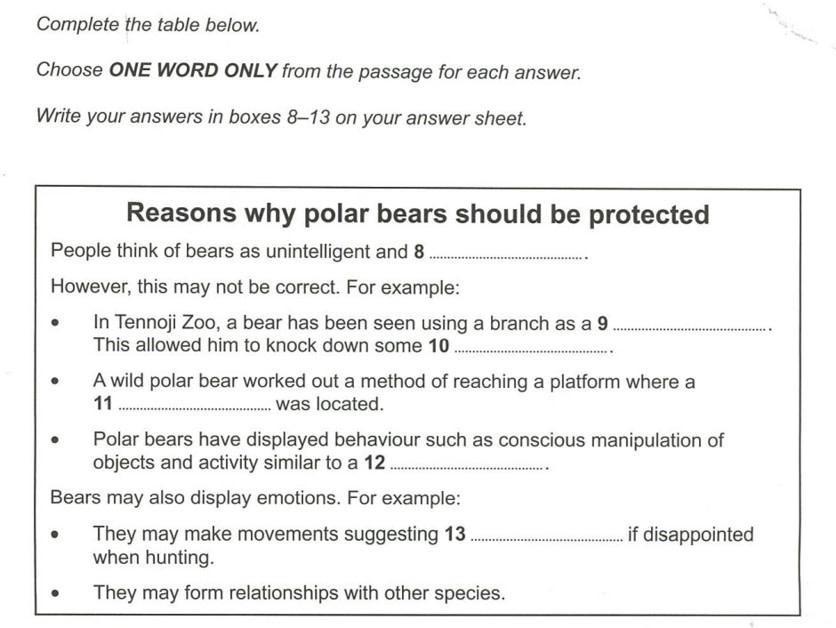
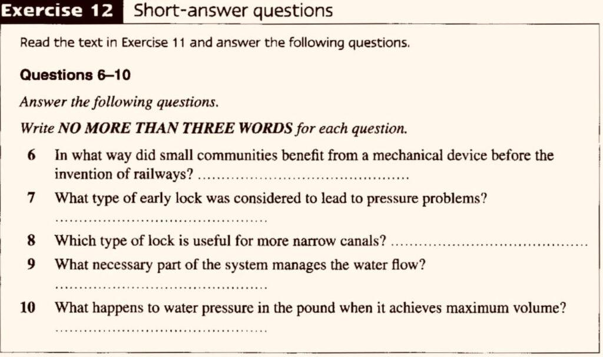
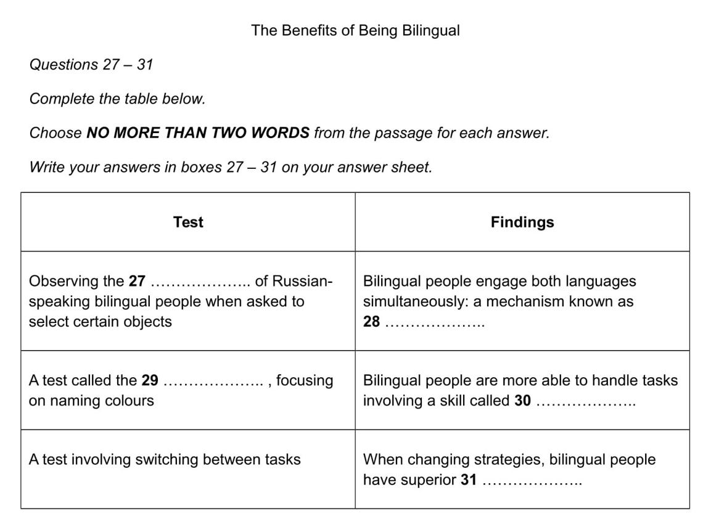
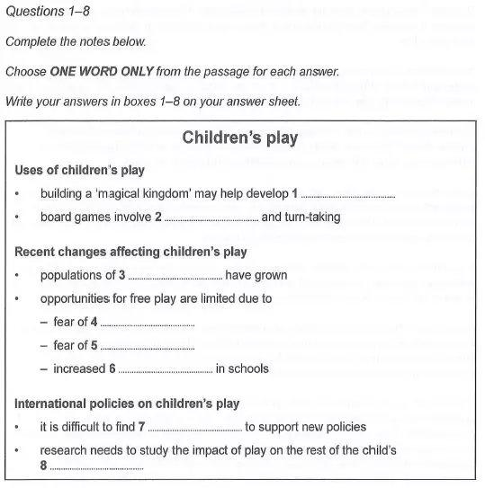
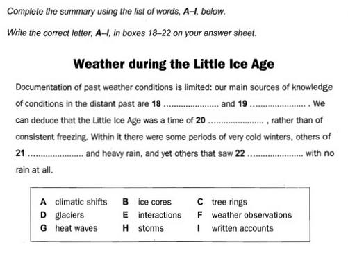
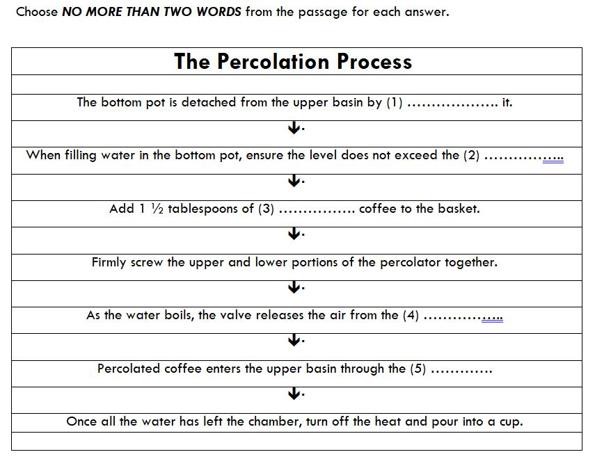
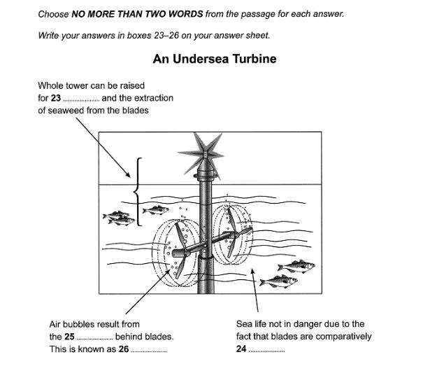

## 1. 这 7 种都属于填词题吗？

是的，都属于广义的 Completion Questions（填空 / 信息补全题）

| 题型                                  | 答案形式        | 答案顺序 | 定位策略 |
| ----------------------------------- | ----------- | ---- | ---- |
| Sentence Completion                 | 填入单词或词组     | 🟢 顺序 | 按题目顺序向后找 |
| Short Answer Questions              | 用原文单词或数字回答  | 🟢 顺序 | 按题目顺序向后找 |
| Table Completion                    | 补充表格信息      | 🟡 不保证顺序 | 根据表格逻辑及原文定位 |
| Note Completion                     | 补充笔记中的信息    | 🟡 通常局部组织 | 结合笔记结构定位 |
| Summary Completion                  | 补充摘要缺失信息    | 🟡 不保证顺序 | 定位摘要对应原文区域 |
| Flow-chart Completion               | 补充流程步骤      | 🟡 流程逻辑有序 | 按过程步骤理解，不盲目套原文顺序 |
| Diagram Labeling / Label Completion | 填写图示中的名称或标签 | 🔴 不保证顺序 | 根据图中位置、结构和原文描述定位 |

它们的共同特点是：

- 题目留有空缺
- 你需要从原文提取信息
- 通常需要填写原文中的词或词组
- 有字数限制，例如 `NO MORE THAN TWO WORDS`
- 主要考查定位、同义替换、上下文理解和词性判断

官方对填空题的说明中，Sentence Completion 和 Short Answer Questions 的答案按照原文信息顺序出现；Summary、Note、Table 和 Flow-chart Completion 的答案不一定按照原文顺序出现，但通常集中在原文某一个部分；Diagram Label Completion 也不保证答案顺序与原文一致

[IELTS Academic: Reading test format](https://www.ielts.org/take-a-test/test-types/ielts-academic-test/ielts-academic-format-reading)

## 2. 其实可以把这 7 种题型合并成一个大类

### Completion Questions — 填词题

核心能力：定位原文 → 理解上下文 → 提取答案 → 检查词数与语法

#### A. 直接填空

- Sentence Completion
- Short Answer Questions
#### B. 信息结构填空

- Table Completion
- Note Completion
#### C. 内容概括填空

- Summary Completion
#### D. 过程与图示填空

- Flow-chart Completion
- Diagram Labeling

这样就形成了 **4 个子类别、7 种具体题型**

## 3. 这 7 种题型有什么区别？

### A. 直接填空

#### A.1. Sentence Completion — 句子填空

题目给出一个完整句子，但是缺少部分信息

例如：

> The research was conducted in __

你需要在原文中定位研究发生的地点，然后填入答案

特点：

- 句子结构比较完整
- 上下文提示比较明确
- 可以利用语法判断空格所需词性
- 通常按照原文信息顺序出现

#### A.2. Short Answer Questions — 简答题

题目直接提问，你需要用原文信息回答

例如：

> What year was the research conducted?

答案：

> 1998

特点：

- 题目通常直接提供疑问词
- 需要判断问题询问时间、地点、人物、原因还是方式
- 答案通常按照原文顺序出现
- 需要遵守字数限制

### B. 信息结构填空

#### B.3. Table Completion — 表格填空

题目以表格形式组织信息

例如：

| Year | Development               |
| ---- | ------------------------- |
| 1980 | First research            |
| 1990 | ______                    |
| 2000 | New technology introduced |

你需要理解行和列之间的关系，然后找到对应信息

特点：

- 需要理解表格分类
- 可能涉及时间、地点、对象、特征或数据
- 答案通常集中在文章的相关部分
- **不能完全依赖题目排列顺序判断答案在原文中的顺序**

#### B.4 Note Completion — 笔记填空

题目将文章内容整理成笔记形式

例如：

**Advantages of the new system**

- Lower cost
- Improved __
- Reduced time

特点：

- 信息通常被压缩成短语
- 需要理解关键词之间的关系
- 需要判断空格的词性
- 经常涉及原文同义替换

### C. 内容概括填空

#### C.5. Summary Completion — 摘要填空

题目将原文某一部分概括成一段摘要，让你补充缺失内容

例如：

> The new technology helped companies reduce costs and improve __

特点：

- 题目不是直接复制原文句子
- 需要理解整段内容
- 原文和题目之间经常存在同义替换
- 答案通常来自文章的某一个局部区域，而不是全文各处
- 题目答案可能不按照原文顺序出现

### D. 过程与图示填空

#### D.6. Flow-chart Completion — 流程图填空

题目通过箭头和步骤展示某个过程

例如：

Raw materials → Processing → ___ → Final product

特点：

- 考查过程和步骤
- 理解先后顺序
- 经常涉及动作、阶段、材料或结果
- 流程自身有顺序，但不代表答案一定按照文章段落顺序排列

#### D.7. Diagram Labeling — 图示标注填空

题目提供一张结构图、设备图、建筑图或其他示意图，让你填写对应部位的名称

特点：

- 考查结构、位置和空间关系
- 需要理解原文的描述
- 需要将文字信息和图片中的位置对应起来
- 答案通常来自原文某个局部区域，不保证按照原文顺序出现

## 4. 填词题学习路线

**第一课：填词题通用解题方法**

关键词定位 · 同义替换 · 词性判断 · 字数限制

**第二课：Sentence Completion**

学习顺序定位，练习原文信息提取

**第三课：Short Answer Questions**

训练疑问词判断和精准回答

**第四课：Table & Note Completion**

训练结构化信息提取

**第五课：Summary Completion**

训练概括理解与同义替换

**第六课：Flow-chart Completion**

训练过程、步骤和逻辑关系

**第七课：Diagram Labeling**

训练空间结构与图文对应
