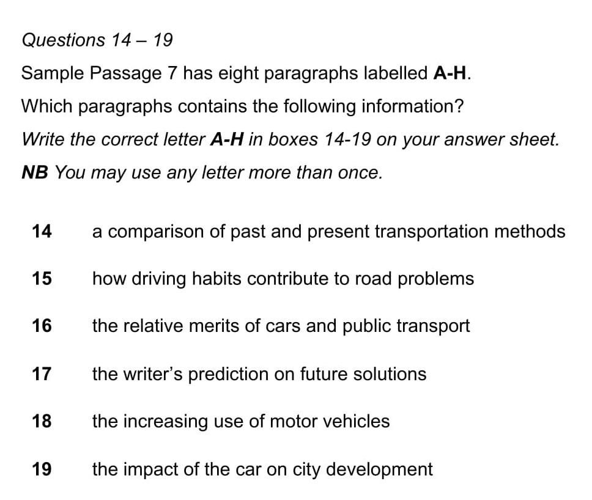

## 1. 什么是段落配对题？

段落配对题（Matching Information）是雅思阅读中的细节信息匹配题

题目给出若干条具体信息，要求考生判断每条信息出现在哪一个段落中，并将题目与对应段落（A、B、C、D...）进行匹配

**核心考查：** 定位段落中的特定细节信息，而不是概括段落的中心思想

## 2. 题型示例

## 3. 题型特点

### 3.1. 考查内容

- 考查段落中的具体细节信息
- 不需要理解整个段落的中心思想
- 重点关注题干与原文之间的同义替换

### 3.2. 题目顺序

- 属于乱序题
- 题目顺序通常不按照原文段落顺序排列
- 不能依靠上一题的答案位置推测下一题

### 3.3. NB 提示

NB 是拉丁语 _Nota Bene_ 的缩写，表示特别注意

常见指令：

**NB: You may use any letter more than once**

意思是：同一个段落字母可以使用多次

- 一个段落可能包含多道题的答案
- 已经匹配过的段落，仍然可以作为后续题目的答案
- 不能因为某段已经使用过，就直接排除该段

## 4. 解题思路

### 4.1. 划：提取题干关键词

- 找出题干中的核心信息
- 优先选择具有区分度的特殊定位词
- 每道题重复出现的词，以及文章标题中的词，通常不能作为有效的特殊定位词

### 4.2. 预判：将题干具体化

从以下四个层面进行预判
#### 4.2.1. 宽泛名词

**数字类**

| 题干概括词                     | 原文可能出现       |
| ------------------------- | ------------ |
| period                    | 10 years     |
| financial / cost / money  | ¥200         |
| proportion / rate / ratio | 2%           |
| data / statistic / number | 1,000 people |

**复数类**

|题干概括词|原文可能出现|
|---|---|
|stages|first → then → finally|
|books|novels, textbooks|
|animals|lions, elephants|

**专有名词类**

|题干概括词|原文可能出现|
|---|---|
|location|Paris|
|term|Artemisia|
|researcher|具体人名|
|organisation|具体机构名称|

#### 4.2.2. 情感指向

**正向情感指示词**

`positive / beneficial / increase / grow / improve / successful / advantage / effective`

**负向情感指示词**

`negative / not / decline / damage / lost / disadvantage / unsuccessful / ineffective`

#### 4.2.3. 逻辑关系

**并列或举例**

|题干|原文|
|---|---|
|examples of|such as / for example|
|an example of|for instance|
|different|and / or / also / similarly|

**因果关系**

|题干|原文|
|---|---|
|reason|because / since / as|
|why|why / due to|
|result / outcome|as a result / therefore|
|cause|lead to / result in|

**时间关系**

|题干|原文|
|---|---|
|before / prior to|previously / earlier|
|then|afterwards / subsequently|
|first|initially|
|finally|eventually / ultimately|

**比较关系**

|题干|原文|
|---|---|
|than|compared with|
|more|greater / higher|
|less|lower / fewer|
|similar|alike / similarly|
|different|unlike / in contrast|

#### 4.2.4. 文章结构

| 题干信息           | 原文可能出现的结构      |
| -------------- | -------------- |
| 原因（reason）     | 解释原因           |
| 结果（result）     | 描述影响           |
| 举例（example）    | 观点之后的具体案例      |
| 比较（comparison） | 两个对象进行比较       |
| 过程（process）    | 按时间或阶段展开       |
| 问题与解决方案        | 先提出问题，再给出解决方案  |
| 定义（definition） | 解释概念或术语        |
| 研究发现（finding）  | 实验、调查或数据分析后的结论 |

### 4.3. 定位：回原文寻找对应信息

- 根据特殊定位词或具体化后的信息，扫描各个段落
- 注意同义替换，不要只寻找题干原词
- 找到疑似位置后，阅读定位句及其前后相关句子
- 一般不需要逐字阅读完整段落，因为本题考查的是特定细节，而不是段落主旨
- 如果定位词不明显、信息分散，或者需要结合上下文理解逻辑关系，则需要扩大阅读范围，必要时读完整个段落
- 有 NB 提示时，不要排除已经匹配过的段落，因为一个段落可能对应多道题

### 4.4. 验证：确认答案

- 确认原文与题干表达的是同一个意思
- 注意否定、转折、比较、因果等逻辑关系
- 不要因为段落出现了相同的主题词，就直接选择该段落
- 确认具体信息匹配后，再填写段落字母

## 5. 核心注意事项

1. 段落配对题考查细节，不是段落主旨
2. 重点关注特殊定位词和同义替换
3. 题目通常乱序，需要独立定位
4. 一般不需要读完整段落，但必须保证理解定位信息
5. NB 提示允许同一个段落匹配多道题
